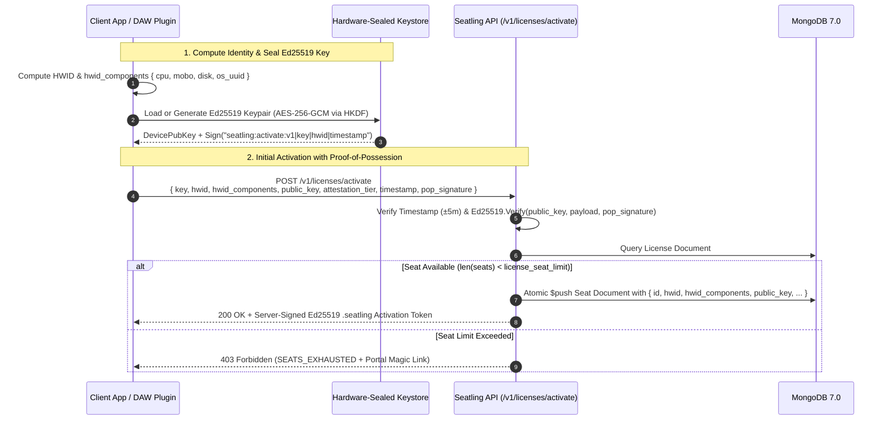
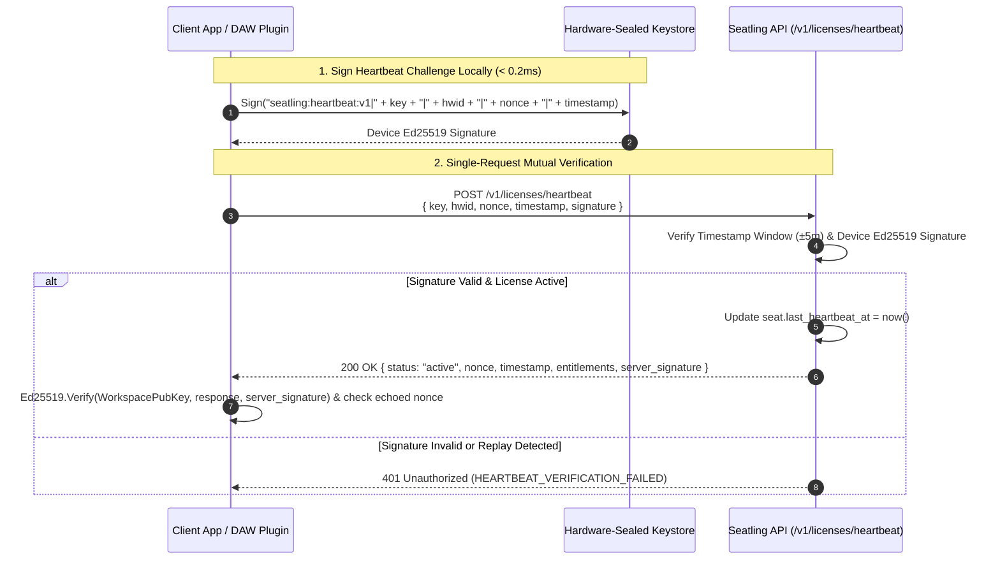
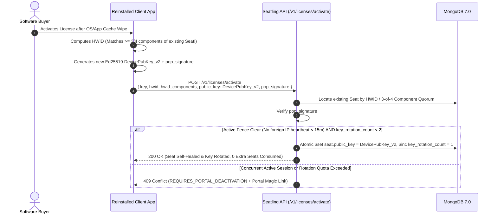

# Seatling Architectural RFC: The Hybrid Hardware Anchor Architecture

> **Document**: `HARDWARE_ANCHOR.md`  
> **Status**: Approved Architecture / Phase 2 Specification  
> **Target Phase**: Phase 2 (True Seat Management & HWID Locking)  
> **Author**: Antigravity Core Architecture Team  
> **Keywords**: Ed25519, Zero-Prompt Keystore, HKDF-SHA256, AES-256-GCM, HWID Fuzzy Matching, Seat Management, Anti-Cloning, Mutual Challenge-Response, VST3 / Electron SDKs  

---

## 1. Executive Summary

A proposal was evaluated to replace Seatling's multi-factor Hardware Fingerprint (HWID) hashing engine entirely with **hardware-backed cryptographic key generation** via platform security coprocessors (Windows TPM 2.0 `NCrypt`, Apple Secure Enclave / macOS Keychain, and Linux `tpm2-tss` / `libsecret`).

### The Architectural Verdict
Adopting raw hardware coprocessor or OS Keychain keys as a standalone replacement for deterministic HWID introduces severe user experience regressions—most notably **reinstall seat burnout**, **blocking macOS Keychain password popups across DAWs (Ableton Live, Logic Pro, FL Studio)**, **missing Apple provisioning entitlement crashes inside audio/3D plugins (`errSecMissingEntitlement`)**, and **cryptographic algorithm mismatches (`ECDSA P-256` vs. `Ed25519`)**.

Instead, Seatling adopts a **Zero-Prompt, Pure-`Ed25519` Hybrid Hardware Anchor Architecture**:
1. **Layer 1: Deterministic Component-Vector HWID (Seat Identity & Fuzzy Quorum)**  
   Individual SHA-256 component hashes (`cpu`, `mobo`, `disk`, `os_uuid`) establish the physical machine anchor with **3-of-4 fuzzy matching**, surviving app uninstalls, cache clears, and minor hardware upgrades.
2. **Layer 2: Zero-Prompt Hardware-Sealed `Ed25519` Keypair (Possession & Anti-Cloning)**  
   A fast, non-prompting `Ed25519` keypair whose private key is sealed at rest via **`AES-256-GCM`** using a wrapping key dynamically derived via **`HKDF-SHA256`** from silent kernel hardware registers (macOS `IOPlatformUUID` + `IOPlatformSerialNumber`, Windows `CRYPTPROTECT_UI_FORBIDDEN` DPAPI + SMBIOS UUID, Linux DMI + `/etc/machine-id`).

This specification details why raw coprocessor/keychain APIs fail in creator workflows, defines the **Zero-Prompt `Ed25519` Hybrid Hardware Anchor**, specifies the **Hardened Bidirectional Self-Healing** rules, and outlines the **Open-Source Client SDK Distribution Model** for VST3/C++, Rust/Tauri, and JavaScript/Electron.

---

## 2. Critical Evaluation: Why Raw Coprocessor & OS Keychain Keys Fail in Creator Software

While hardware security modules (TPM 2.0 / Apple Secure Enclave) and OS Keychains provide non-exportable key storage for standalone enterprise software, relying on them directly in independent creator software causes five critical failures:

### Trap 1: The "Cross-DAW OS Popup" & Plugin Entitlement Failure (Critical UX Regression)
* Creators selling on Gumroad, Lemon Squeezy, and Polar heavily populate the **audio plugin (`VST3`, `AU`, `AAX`)** and **3D addon (`Blender`, `Unreal`, `Maya`)** ecosystems.
* **macOS Keychain ACL Prompts**: Items stored in the macOS Login Keychain bind their Access Control List (ACL) to the **host executable binary** that created them (e.g., `Ableton Live.app`). When the user later opens **Logic Pro**, **Reaper**, or **FL Studio** and loads the exact same plugin, macOS treats the new host as an unauthorized application and blocks the thread with a modal system dialog:
  > *"Logic Pro wants to use your confidential information stored in 'Seatling Key' in your keychain. Enter your macOS password to allow this."*
* **Apple Secure Enclave Rejection (`-34018`)**: Accessing `kSecAttrTokenIDSecureEnclave` requires the **host executable** to be compiled with an Apple Developer Provisioning Profile containing explicit `keychain-access-groups` entitlements. Because a plugin developer does not control Ableton's or Blender's binary entitlements, Secure Enclave calls fail immediately with `errSecMissingEntitlement (-34018)`.
* **Windows TPM Latency & Linux Keyring Prompts**: Physical TPM 2.0 chips communicate over a slow SPI/LPC bus (`20ms–80ms` per signing operation) and hold only ~3 active sessions in silicon RAM—stalling DAW project loads when 20+ plugin instances initialize simultaneously. On Linux, `libsecret` triggers a modal *"Unlock Keyring"* dialog when the desktop boots via auto-login.

### Trap 2: The "Reinstall Seat-Burnout" Trap
* **The Mechanism**: Cryptographic key pairs are **non-deterministic**. Generating a key creates a fresh, random key pair whose storage file or reference handle lives in the application's local data directory (`%LOCALAPPDATA%` or `~/Library/Application Support`).
* **The Failure**:
  1. A paying customer uninstalls the application or runs a system cleaner (`CCleaner`, `CleanMyMac`), wiping the local keystore.
  2. Upon reinstalling, the client generates a brand-new `Ed25519` key pair and sends the new `PublicKey` to Seatling.
  3. Under a "Key-Only" architecture, the server only recognizes public keys and treats the reinstalled app as a completely new computer—burning an extra seat on the *exact same physical machine* and locking the customer out (`SEATS_EXHAUSTED`).

### Trap 3: Cryptographic Algorithm Fragmentation (`ECDSA P-256` vs. `Ed25519`)
* Apple Secure Enclave and commercial Windows TPM 2.0 chips only support **NIST P-256 (`ecdsa-sha256`)** or legacy **RSA-2048**; they do not support **`Ed25519`**.
* Standardizing on a software-generated, hardware-sealed **`Ed25519`** keypair unifies Seatling's entire cryptographic stack on Go's standard `crypto/ed25519` (Rule 4 in [AGENTS.md](./AGENTS.md)) with `< 0.1ms` verification times and compact 32-byte keys / 64-byte signatures.

### Trap 4: Linux Sandboxes & Container Fragmentation
* Containerized Linux desktop formats (**Flatpak**, **Snap**, **AppImage**) and WSL2/Docker environments block access to `/dev/tpmrm0` and `tss` system groups by default, causing hardware TPM calls to fail for standard unprivileged users.

---

## 3. The Solution: The Zero-Prompt `Ed25519` Hybrid Hardware Anchor

Instead of choosing between spoofable hardware hashes and brittle OS keychains, Seatling combines **Deterministic Component-Vector HWID** with a **Zero-Prompt Hardware-Sealed `Ed25519` Keystore**:

```text
┌─────────────────────────────────────────────────────────────────────────────────┐
│                              CLIENT DEVICE IDENTITY                             │
├────────────────────────────────────────┬────────────────────────────────────────┤
│     LAYER 1: DETERMINISTIC ANCHOR      │    LAYER 2: HARDWARE-SEALED ED25519    │
│   (Identifies the physical machine)    │  (Proves possession & blocks cloning)  │
├────────────────────────────────────────┼────────────────────────────────────────┤
│  • cpu:     SHA256(Normalized CPU ID)  │  • Fast Ed25519 Keypair (< 0.1ms sign) │
│  • mobo:    SHA256(Motherboard UUID)   │  • Private key encrypted on disk via   │
│  • disk:    SHA256(Primary Disk UUID)  │    AES-256-GCM                         │
│  • os_uuid: SHA256(OS Machine GUID)    │  • Wrapping Key derived via HKDF from: │
│  ───────────────────────────────────── │    - macOS: IOKit IOPlatformUUID + S/N │
│  • Composite HWID Digest (SHA-256)     │    - Win: Silent DPAPI + SMBIOS UUID   │
│  • Server 3-of-4 Quorum Fuzzy Match    │    - Linux: DMI UUID + /etc/machine-id │
└────────────────────────────────────────┴────────────────────────────────────────┘
                                    │
                                    ▼
             Transmitted to Seatling Core (services/api)
```

### How the "Zero-Prompt Hardware-Sealed Keystore" Works
1. **Key Generation**: On first activation, the Seatling SDK generates a standard `crypto/ed25519` keypair in memory.
2. **Hardware-Derived Key Wrapping (`HKDF-SHA256` + `AES-256-GCM`)**:
   Before saving the `Ed25519` private key to the shared user data directory (`~/Library/Application Support/Seatling/<workspace_id>/keystore.bin` or `%LOCALAPPDATA%\Seatling\<workspace_id>\keystore.bin`), the SDK derives a 256-bit wrapping key using `HKDF-SHA256` from **unprivileged, non-prompting kernel hardware identifiers**:
   - **macOS**: `IOPlatformUUID` + `IOPlatformSerialNumber` read directly from the IOKit registry (`IOServiceGetMatchingService("IOPlatformExpertDevice")`). Takes `< 0.2ms`, requires zero entitlements, never touches the macOS Keychain, and produces the exact same key across Ableton Live, Logic Pro, Pro Tools, and standalone apps.
   - **Windows**: `CryptProtectData` with the strict **`CRYPTPROTECT_UI_FORBIDDEN`** flag (Windows DPAPI tied to the Windows User session, not the `.exe` binary) combined with `MachineGuid` and SMBIOS System UUID. Guarantees zero UI prompts across all host processes.
   - **Linux**: `/sys/class/dmi/id/product_uuid` (or board serial) + `/etc/machine-id` + user UID.
3. **Why Copying Files Fails Immediately**:
   If a user zips up their application folder, `.seatling` license file, or `keystore.bin` and shares it online (or copies it to a second computer), the second computer has a different `IOPlatformUUID` / SMBIOS UUID / DPAPI master secret. When the second computer runs `AES-256-GCM` decryption on `keystore.bin`, authentication fails immediately, preventing the pirate from signing heartbeats or activation proofs.

---

## 4. Hardware Attestation Tiers

Seatling client SDKs operate across two silent, pure-`Ed25519` tiers without ever triggering OS dialogs:

| Tier | Value | Protection Mechanism | Target Environments | Clone & Sharing Resistance |
| :--- | :--- | :--- | :--- | :--- |
| **Tier 1: Hardware-Sealed `Ed25519`** *(Default)* | `"hardware_sealed"` | `Ed25519` private key encrypted with `AES-256-GCM` via `HKDF-SHA256` over kernel IOKit / SMBIOS hardware serials + silent Windows DPAPI (`CRYPTPROTECT_UI_FORBIDDEN`) | Windows 10/11, macOS (Intel & Apple Silicon), Desktop Linux, all VST3/AU/AAX DAWs, Electron & Tauri apps | **High** — Keystore is cryptographically undecryptable if copied to another machine; `0` OS popups; `< 0.2ms` execution |
| **Tier 0: Software `Ed25519`** *(Fallback)* | `"software"` | Obfuscated `Ed25519` keypair bound to available container/OS identifiers + server-side HWID fuzzy matching | Restricted Linux sandboxes, Docker containers, virtualized environments with masked DMI tables | **Standard** — Protected via application-level key obfuscation and server-side Active Heartbeat Fencing |

---

## 5. End-to-End Workflows & Security Guards

### 5.1. Initial License Activation with Proof-of-Possession (`POST /v1/licenses/activate`)

To prevent an attacker from registering arbitrary or spoofed public keys, initial seat activation requires a cryptographic **Proof-of-Possession (PoP)** signature over the activation payload:



---

### 5.2. Single-Endpoint Mutual-Challenge Heartbeat (`POST /v1/licenses/heartbeat`)

Seatling eliminates the latency and state overhead of a separate `/challenge` endpoint by using a **single-round-trip (`1-RTT`) Mutual-Challenge Heartbeat**:

1. **Client Request Signature**: The client generates a fresh cryptographic `nonce` and `timestamp`, signs canonical payload `"seatling:heartbeat:v1|<key>|<hwid>|<nonce>|<timestamp>"` using its Hardware-Sealed `Ed25519` private key, and sends a single request to `POST /v1/licenses/heartbeat`.
2. **Server Verification**: `services/api` verifies that `timestamp` is within $\pm 5$ minutes of server UTC time and validates `Ed25519.Verify(seat.PublicKey, payload, signature)`.
3. **Server Response Counter-Signature**: The server updates `seat.last_heartbeat_at` and returns a `200 OK` response signed by the workspace's `Ed25519` private key that **echoes the client's `nonce`**, preventing MITM proxy replay (`Charles`, `mitmproxy`, `Fiddler`).



---

### 5.3. Hardened Bidirectional Self-Healing Workflow

To prevent the "Reinstall Seat-Burnout" trap **without** opening a loophole where pirates sharing a `(key, hwid)` string can endlessly overwrite each other's `PublicKey`, Seatling enforces **Hardened Bidirectional Self-Healing**:

#### Case A: App Reinstall / Cache Wipe (Layer 1 Heals Layer 2 — Fenced & Rate-Limited)
When a user wipes their local app data and reinstalls on the **same physical machine**, `HWID` matches an existing seat (exact match or $\ge 3\text{-of-}4$ `hwid_components` match), but the client presents a new `DevicePubKey_v2` with a valid `pop_signature`.
The server rotates the key in-place (`0` seats burned) **if and only if all three security guards pass**:
1. **Valid Proof-of-Possession**: `pop_signature` is cryptographically valid for `DevicePubKey_v2`.
2. **Active Heartbeat Fence (Anti-Sharing Guard)**: The existing seat's prior key (`DevicePubKey_v1`) has **not** recorded an active heartbeat from a distinct IP address within the last **15 minutes**. (If another machine is actively heartbeating with `DevicePubKey_v1` right now, silent rotation is blocked with `409 Conflict: SEAT_ACTIVE_ELSEWHERE`).
3. **Monthly Rotation Quota**: `seat.key_rotation_count < 2` within the rolling 30-day window. Exceeding 2 key rotations per month requires a 1-click deactivation via the Customer Portal (`portal.seatling.com`).



#### Case B: Hardware / Major OS Upgrade (Layer 2 Heals Layer 1)
If a buyer upgrades multiple hardware components or performs a major OS migration that causes more than 1 `hwid_components` entry to drift, **but their `keystore.bin` (`DevicePubKey`) remains intact and signs a valid `Ed25519` proof**, the server recognizes the existing `seat.PublicKey` and automatically updates `seat.HWID` and `seat.HWIDComponents` in-place without consuming a new seat.

---

## 6. Data Model Specifications (`services/shared/models/license.go`)

To support the Zero-Prompt `Ed25519` Hybrid Hardware Anchor while preserving compatibility with Customer Portal seat deactivation (`Seat.ID`), the `Seat` model in [`services/shared/models/license.go`](./services/shared/models/license.go) is structured as follows:

```go
package models

import (
	"time"
)

// AttestationTier represents the protection level of the device's Ed25519 private key at rest.
type AttestationTier string

const (
	AttestationTierHardwareSealed AttestationTier = "hardware_sealed" // AES-256-GCM wrapped via HKDF(IOKit/SMBIOS + silent DPAPI)
	AttestationTierSoftware       AttestationTier = "software"        // Obfuscated local software keystore fallback
)

// Seat represents a bound machine slot allocated to a license.
type Seat struct {
	ID             string            `bson:"id,omitempty" json:"id"`
	HWID           string            `bson:"hwid" json:"hwid"`
	HWIDComponents map[string]string `bson:"hwid_components,omitempty" json:"hwid_components,omitempty"` // {"cpu": "...", "mobo": "...", "disk": "...", "os_uuid": "..."}
	MachineName    string            `bson:"machine_name" json:"machine_name"`
	OS             string            `bson:"os" json:"os"`
	AppVersion     string            `bson:"app_version" json:"app_version"`

	// Cryptographic Proof (Layer 2 - Pure Ed25519)
	PublicKey        string          `bson:"public_key" json:"public_key"`                             // Base64-encoded 32-byte Ed25519 public key
	AttestationTier  AttestationTier `bson:"attestation_tier" json:"attestation_tier"`                 // "hardware_sealed" or "software"
	KeyRotatedAt     *time.Time      `bson:"key_rotated_at,omitempty" json:"key_rotated_at,omitempty"` // Last self-healing key rotation timestamp
	KeyRotationCount int             `bson:"key_rotation_count" json:"key_rotation_count"`             // Rolling 30-day rotation counter (max 2)

	// Timestamps & Audit
	ActivatedAt     time.Time `bson:"activated_at" json:"activated_at"`
	LastHeartbeatAt time.Time `bson:"last_heartbeat_at" json:"last_heartbeat_at"`
	IPAddress       string    `bson:"ip_address,omitempty" json:"ip_address,omitempty"`
}
```

---

## 7. Client SDK Distribution & Open-Source Security Model

Seatling serves creators building across **C++ (Desktop GUI, CLI tools, native services, Unreal)**, **Rust (`Tauri`, native CLI/GUI)**, and **JavaScript / TypeScript (`Electron`, `Node.js`)**.

### 7.1. Why Seatling Client SDKs Are Open-Source (Kerckhoffs's Principle)
Independent software creators and studios strongly reject opaque, closed-source DRM dynamic libraries (such as iLok PACE or Denuvo) that trigger crashes, block architecture transitions (e.g., Apple Silicon), or raise privacy concerns.

Seatling **makes all client SDKs source-available under the Business Source License 1.1 (BSL 1.1 / BUSL-1.1)** while maintaining high security:
1. **Asymmetric Root of Trust**: Only `services/api` holds the workspace `Ed25519` private key used to sign `.seatling` activation tokens and `/heartbeat` responses. Inspecting the open-source SDK only reveals `ed25519.Verify(WORKSPACE_PUBLIC_KEY, ...)`—giving an attacker zero ability to forge server tokens.
2. **Machine-Intrinsic `AES-256-GCM` Sealing**: Knowing the public `HKDF-SHA256` derivation formula does not allow User B to decrypt User A's `keystore.bin`, because User B's physical machine possesses a different `IOPlatformUUID`, SMBIOS UUID, and Windows DPAPI master secret.
3. **Server-Side Active Heartbeat Fencing**: Even if a buyer extracts their own raw keys and publishes them online, concurrent heartbeats or key rotations from multiple IPs trip the server-side fence and lock the shared seat.

### 7.2. Ecosystem-Specific Packaging & Anti-Tamper Hardening

To protect creators not only against **license key sharing** (solved by the cryptographic protocol) but also against **casual local binary/script patching** (editing an app locally to skip the `verify()` check), Seatling distributes its SDKs in formats tailored to each runtime:

| Target Ecosystem | Package Format | Why This Format Is Mandatory | Anti-Patching & Thread-Safety Design |
| :--- | :--- | :--- | :--- |
| **C++ / Native Applications (Desktop GUI, CLI, Unreal)** | **C++ Library (`seatling.hpp`)** linking Static Library (`.a` / `.lib`) | Shipping external `.dll` or `.dylib` files breaks macOS notarization, `@rpath` resolution, and creates runtime DLL search failures. | **Static Linking**: Verification logic and Rust core are bundled directly into the application binary with zero external dynamic dependencies. **Zero Hot-Path I/O**: Reads cached `.seatling` state in `< 0.01ms` on background worker threads or render loops. |
| **Rust / Tauri Desktop Apps** | **Cargo Crate (`seatling-rs`)** | Compiles directly into the native `src-tauri` Rust binary rather than running in the frontend WebView. | Executes in compiled native machine code isolated from browser DevTools. |
| **JavaScript / Electron / Node.js** | **Native N-API Addon (`@seatling/node` built via `@napi-rs` from `seatling-rs`)** | Plain JavaScript inside an Electron `app.asar` archive can be unpacked and edited in seconds with `npx asar extract`. | By compiling the open-source Rust core into a prebuilt **native `.node` binary addon** (`win32-x64`, `darwin-arm64`, `darwin-x64`, `linux-x64`), HWID collection, `HKDF` key unsealing, and `Ed25519` verification run inside compiled native code rather than plain-text JS. |

### 7.3. Signed Runtime Entitlements (Functional Coupling)
Rather than returning a simple boolean (`{ "valid": true }`) that is trivial to patch out in a local binary, Seatling signed tokens and heartbeat payloads carry **signed runtime `metadata` / `entitlements` constants** (e.g., export resolution limits, cloud API endpoints, or preset decryption keys) that the application consumes directly in its feature logic.

---

## 8. Comparative Analysis Matrix

| Evaluation Criteria | Pure HWID String | Raw TPM / OS Keychain (Approach A) | **Zero-Prompt `Ed25519` Hybrid Anchor (Approved)** |
| :--- | :--- | :--- | :--- |
| **Resistance to Traffic Sniffing / Replay** | ❌ Vulnerable (Static string replay) | ✅ Immune (Challenge-Response) | ✅ **Immune (1-RTT Mutual-Challenge `Ed25519`)** |
| **Resistance to License / Folder Sharing** | ❌ Weak (HWID string easily copied) | ✅ High | ✅ **High (`AES-256-GCM` bound to IOKit/SMBIOS + DPAPI)** |
| **Zero OS Password Popups Across DAWs** | ✅ Silent | ❌ Fails (macOS Keychain ACL popups) | ✅ **100% Silent (`< 0.2ms`, zero OS prompts)** |
| **Works in VST3/AU Plugins without Entitlements** | ✅ Yes | ❌ Fails (`errSecMissingEntitlement`) | ✅ **Yes (`seatling.hpp` header-only, no entitlements)** |
| **Behavior on App Reinstall / Cache Clear** | ✅ Preserves seat | ❌ Burns a new seat (Key lost) | ✅ **Fenced & rate-limited self-healing (`0` seats burned)** |
| **Behavior on Disk / Minor Hardware Upgrade** | ❌ Breaks single SHA-256 hash | ✅ Key preserved | ✅ **3-of-4 HWID Quorum + Layer 2 $\rightarrow$ Layer 1 Reverse Healing** |
| **Unified `Ed25519` Server & Client Stack** | N/A | ❌ No (Requires `ECDSA P-256` / `RSA`) | ✅ **100% `crypto/ed25519` everywhere** |

---

## 9. Phase 2 Alignment & Deferred Enterprise Scope

### 9.1. Phase 2 Core Deliverables ([PHASE_2.md](./PHASE_2.md))
1. **Deliverable P2_1 (Component-Vector HWID & 3-of-4 Quorum Matching)**:
   - Implement normalization and SHA-256 hashing across `cpu`, `mobo`, `disk`, and `os_uuid` in `services/shared/crypto` and client SDKs.
2. **Deliverable P2_2 (Atomic Seat Activation with PoP & Fenced Self-Healing)**:
   - Extend `POST /v1/licenses/activate` to verify the client's `Ed25519` `pop_signature` and implement bidirectional self-healing guarded by the 15-minute Active Heartbeat Fence and 2-per-month rotation cap.
3. **Deliverable P2_6 (Single-Endpoint Mutual-Challenge Heartbeat)**:
   - Implement `POST /v1/licenses/heartbeat` verifying client `Ed25519` signatures over `{ key, hwid, nonce, timestamp }` and returning workspace-signed `Ed25519` responses echoing `nonce`.

### 9.2. Deferred to Future Phases (Out of Scope for Phase 2)
To keep Phase 2 lean, fast, and laser-focused on indie creators and desktop/plugin developers, the following items are explicitly deferred:
- **Opt-In Hardware Silicon Mode (TPM 2.0 `NCrypt` / Apple Secure Enclave)**: Reserved as a future opt-in tier for standalone enterprise B2B applications.
- **Air-Gapped `.seatling-req` USB Request Ceremony**: Standard `.seatling` signed offline machine files and bounded offline grace periods (`offline_verification_grace_days`) cover Phase 2 offline use cases.
- **B2B Floating CI/CD Short-Lived Leases**: Ephemeral render-farm and build-agent floating lease modes are deferred to post-Phase 2 enterprise expansions.
