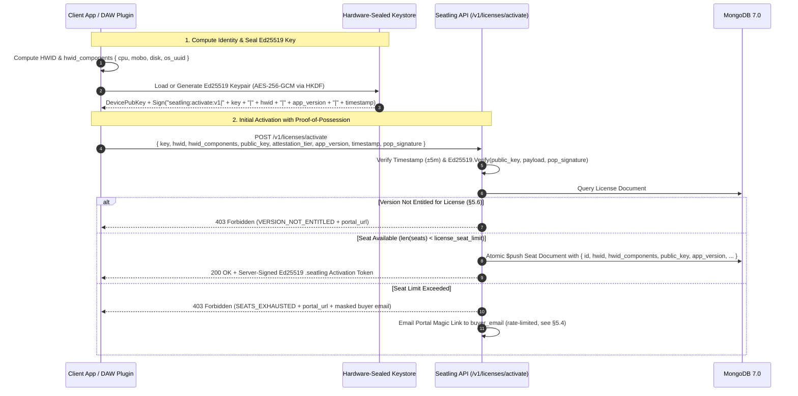
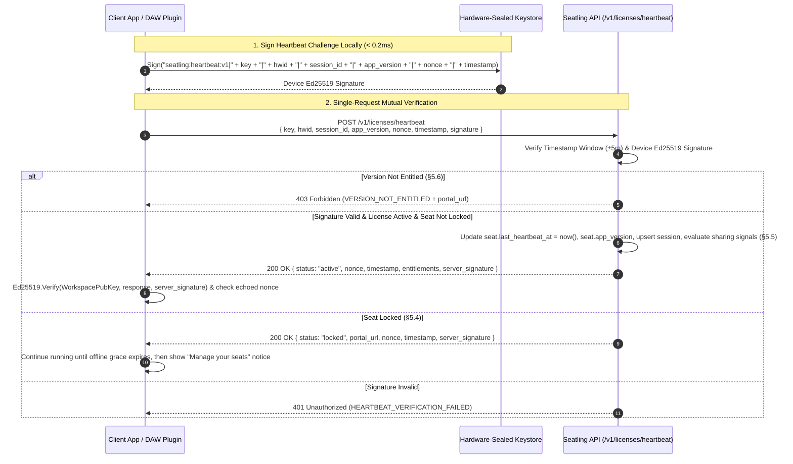
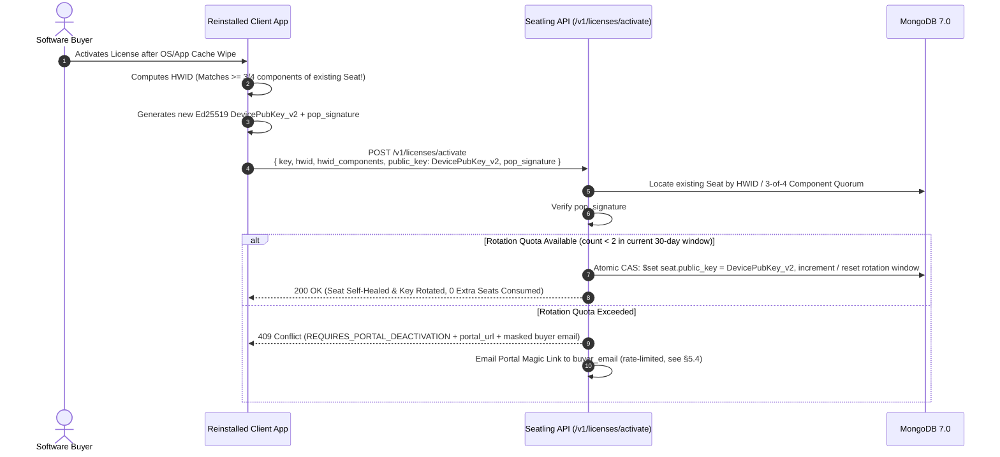

# Seatling Architectural RFC: The Hybrid Hardware Anchor Architecture

> **Document**: `HARDWARE_ANCHOR.md`  
> **Status**: Approved Architecture / Phase 2 Specification  
> **Target Phase**: Phase 2 (True Seat Management & HWID Locking)  
> **Author**: Antigravity Core Architecture Team  
> **Keywords**: Ed25519, Zero-Prompt Keystore, HKDF-SHA256, AES-256-GCM, HWID Fuzzy Matching, Seat Management, Anti-Cloning, Mutual Challenge-Response, VST3 / Electron SDKs  

---

## 1. Executive Summary

A proposal was evaluated to replace Seatling's multi-factor Hardware Fingerprint (HWID) hashing engine entirely with **hardware-backed cryptographic key generation** via platform security coprocessors (Windows TPM 2.0 `NCrypt`, Apple Secure Enclave / macOS Keychain, and Linux `tpm2-tss` / `libsecret`).

### The Architectural Verdict
Adopting raw hardware coprocessor or OS Keychain keys as a standalone replacement for deterministic HWID introduces severe user experience regressions—most notably **reinstall seat burnout**, **blocking macOS Keychain password popups across DAWs (Ableton Live, Logic Pro, FL Studio)**, **missing Apple provisioning entitlement crashes inside audio/3D plugins (`errSecMissingEntitlement`)**, and **cryptographic algorithm mismatches (`ECDSA P-256` vs. `Ed25519`)**.

Instead, Seatling adopts a **Zero-Prompt, Pure-`Ed25519` Hybrid Hardware Anchor Architecture**:
1. **Layer 1: Deterministic Component-Vector HWID (Seat Identity & Fuzzy Quorum)**  
   Individual SHA-256 component hashes (`cpu`, `mobo`, `disk`, `os_uuid`) establish the physical machine anchor with **3-of-4 fuzzy matching**, surviving app uninstalls, cache clears, and minor hardware upgrades.
2. **Layer 2: Zero-Prompt Hardware-Sealed `Ed25519` Keypair (Possession & Anti-Cloning)**  
   A fast, non-prompting `Ed25519` keypair whose private key is sealed at rest via **`AES-256-GCM`** using a wrapping key dynamically derived via **`HKDF-SHA256`** from silent kernel hardware registers (macOS `IOPlatformUUID` + `IOPlatformSerialNumber`, Windows `CRYPTPROTECT_UI_FORBIDDEN` DPAPI + SMBIOS UUID, Linux DMI + `/etc/machine-id`).

This specification details why raw coprocessor/keychain APIs fail in creator workflows, defines the **Zero-Prompt `Ed25519` Hybrid Hardware Anchor**, specifies the **Hardened Bidirectional Self-Healing** rules, and outlines the **Open-Source Client SDK Distribution Model** for VST3/C++, Rust/Tauri, and JavaScript/Electron.

### 1.1. Design Principle: Strict Rules, Fast Recovery

> **Seatling prefers simple, strict server rules backed by a sub-minute, email-gated self-service recovery over complex heuristics that try to avoid every false positive.**

The client device is fully controlled by the buyer, who is also the primary licensing adversary. Seatling therefore does not try to make every edge case invisible to honest buyers; instead, it accepts occasional lockouts and makes recovery trivial. A lockout is acceptable **only if all four guardrails hold**:

| # | Guardrail | Rationale |
| :--- | :--- | :--- |
| G1 | **Rare for honest buyers** | Normal reinstalls and hardware upgrades must self-heal (§5.3) without triggering a lockout. |
| G2 | **Resolvable via the Customer Portal** | The recovery email must actually fix the problem (seat deactivation / quota reset). Problems the portal cannot fix (e.g. client clock skew) must be handled in-protocol instead. |
| G3 | **Recovery reaches only the buyer** | Portal magic links are delivered exclusively to the license's `buyer_email` and are **never** returned in an API response (§5.4). |
| G4 | **Not spammable** | Lockout emails are rate-limited to at most one per license per 6 hours, so a leaked license key cannot be used to flood the buyer's inbox. |

Locked seats continue to run until their offline grace period (`offline_verification_grace_days`) expires; a lockout never interrupts an active session mid-use.

---

## 2. Critical Evaluation: Why Raw Coprocessor & OS Keychain Keys Fail in Creator Software

While hardware security modules (TPM 2.0 / Apple Secure Enclave) and OS Keychains provide non-exportable key storage for standalone enterprise software, relying on them directly in independent creator software causes five critical failures:

### Trap 1: The "Cross-DAW OS Popup" & Plugin Entitlement Failure (Critical UX Regression)
* Creators selling on Gumroad, Lemon Squeezy, and Polar heavily populate the **audio plugin (`VST3`, `AU`, `AAX`)** and **3D addon (`Blender`, `Unreal`, `Maya`)** ecosystems.
* **macOS Keychain ACL Prompts**: Items stored in the macOS Login Keychain bind their Access Control List (ACL) to the **host executable binary** that created them (e.g., `Ableton Live.app`). When the user later opens **Logic Pro**, **Reaper**, or **FL Studio** and loads the exact same plugin, macOS treats the new host as an unauthorized application and blocks the thread with a modal system dialog:
  > *"Logic Pro wants to use your confidential information stored in 'Seatling Key' in your keychain. Enter your macOS password to allow this."*
* **Apple Secure Enclave Rejection (`-34018`)**: Accessing `kSecAttrTokenIDSecureEnclave` requires the **host executable** to be compiled with an Apple Developer Provisioning Profile containing explicit `keychain-access-groups` entitlements. Because a plugin developer does not control Ableton's or Blender's binary entitlements, Secure Enclave calls fail immediately with `errSecMissingEntitlement (-34018)`.
* **Windows TPM Latency & Linux Keyring Prompts**: Physical TPM 2.0 chips communicate over a slow SPI/LPC bus (`20ms–80ms` per signing operation) and hold only ~3 active sessions in silicon RAM—stalling DAW project loads when 20+ plugin instances initialize simultaneously. On Linux, `libsecret` triggers a modal *"Unlock Keyring"* dialog when the desktop boots via auto-login.

### Trap 2: The "Reinstall Seat-Burnout" Trap
* **The Mechanism**: Cryptographic key pairs are **non-deterministic**. Generating a key creates a fresh, random key pair whose storage file or reference handle lives in the application's local data directory (`%LOCALAPPDATA%` or `~/Library/Application Support`).
* **The Failure**:
  1. A paying customer uninstalls the application or runs a system cleaner (`CCleaner`, `CleanMyMac`), wiping the local keystore.
  2. Upon reinstalling, the client generates a brand-new `Ed25519` key pair and sends the new `PublicKey` to Seatling.
  3. Under a "Key-Only" architecture, the server only recognizes public keys and treats the reinstalled app as a completely new computer—burning an extra seat on the *exact same physical machine* and locking the customer out (`SEATS_EXHAUSTED`).

### Trap 3: Cryptographic Algorithm Fragmentation (`ECDSA P-256` vs. `Ed25519`)
* Apple Secure Enclave and commercial Windows TPM 2.0 chips only support **NIST P-256 (`ecdsa-sha256`)** or legacy **RSA-2048**; they do not support **`Ed25519`**.
* Standardizing on a software-generated, hardware-sealed **`Ed25519`** keypair unifies Seatling's entire cryptographic stack on Go's standard `crypto/ed25519` (Rule 4 in [AGENTS.md](./AGENTS.md)) with `< 0.1ms` verification times and compact 32-byte keys / 64-byte signatures.

### Trap 4: Linux Sandboxes & Container Fragmentation
* Containerized Linux desktop formats (**Flatpak**, **Snap**, **AppImage**) and WSL2/Docker environments block access to `/dev/tpmrm0` and `tss` system groups by default, causing hardware TPM calls to fail for standard unprivileged users.

---

## 3. The Solution: The Zero-Prompt `Ed25519` Hybrid Hardware Anchor

Instead of choosing between spoofable hardware hashes and brittle OS keychains, Seatling combines **Deterministic Component-Vector HWID** with a **Zero-Prompt Hardware-Sealed `Ed25519` Keystore**:

```text
┌─────────────────────────────────────────────────────────────────────────────────┐
│                              CLIENT DEVICE IDENTITY                             │
├────────────────────────────────────────┬────────────────────────────────────────┤
│     LAYER 1: DETERMINISTIC ANCHOR      │    LAYER 2: HARDWARE-SEALED ED25519    │
│   (Identifies the physical machine)    │  (Proves possession & blocks cloning)  │
├────────────────────────────────────────┼────────────────────────────────────────┤
│  • cpu:     SHA256(Normalized CPU ID)  │  • Fast Ed25519 Keypair (< 0.1ms sign) │
│  • mobo:    SHA256(Motherboard UUID)   │  • Private key encrypted on disk via   │
│  • disk:    SHA256(Primary Disk UUID)  │    AES-256-GCM                         │
│  • os_uuid: SHA256(OS Machine GUID)    │  • Wrapping Key derived via HKDF from: │
│  ───────────────────────────────────── │    - macOS: IOKit IOPlatformUUID + S/N │
│  • Composite HWID Digest (SHA-256)     │    - Win: Silent DPAPI + SMBIOS UUID   │
│  • Server 3-of-4 Quorum Fuzzy Match    │    - Linux: DMI UUID + /etc/machine-id │
└────────────────────────────────────────┴────────────────────────────────────────┘
                                    │
                                    ▼
             Transmitted to Seatling Core (services/api)
```

### How the "Zero-Prompt Hardware-Sealed Keystore" Works
1. **Key Generation**: On first activation, the Seatling SDK generates a standard `crypto/ed25519` keypair in memory.
2. **Hardware-Derived Key Wrapping (`HKDF-SHA256` + `AES-256-GCM`)**:
   Before saving the `Ed25519` private key to the shared user data directory (`~/Library/Application Support/Seatling/<workspace_id>/keystore.bin` or `%LOCALAPPDATA%\Seatling\<workspace_id>\keystore.bin`), the SDK derives a 256-bit wrapping key using `HKDF-SHA256` from **unprivileged, non-prompting kernel hardware identifiers**:
   - **macOS**: `IOPlatformUUID` + `IOPlatformSerialNumber` read directly from the IOKit registry (`IOServiceGetMatchingService("IOPlatformExpertDevice")`). Takes `< 0.2ms`, requires zero entitlements, never touches the macOS Keychain, and produces the exact same key across Ableton Live, Logic Pro, Pro Tools, and standalone apps.
   - **Windows**: `CryptProtectData` with the strict **`CRYPTPROTECT_UI_FORBIDDEN`** flag (Windows DPAPI tied to the Windows User session, not the `.exe` binary) combined with `MachineGuid` and SMBIOS System UUID. Guarantees zero UI prompts across all host processes.
   - **Linux**: `/sys/class/dmi/id/product_uuid` (or board serial) + `/etc/machine-id` + user UID.
3. **Why Copying Files Fails Immediately**:
   If a user zips up their application folder, `.seatling` license file, or `keystore.bin` and shares it online (or copies it to a second computer), the second computer has a different `IOPlatformUUID` / SMBIOS UUID / DPAPI master secret. When the second computer runs `AES-256-GCM` decryption on `keystore.bin`, authentication fails immediately, preventing the pirate from signing heartbeats or activation proofs.

---

## 4. Hardware Attestation Tiers

Seatling client SDKs operate across two silent, pure-`Ed25519` tiers without ever triggering OS dialogs:

| Tier | Value | Protection Mechanism | Target Environments | Clone & Sharing Resistance |
| :--- | :--- | :--- | :--- | :--- |
| **Tier 1: Hardware-Sealed `Ed25519`** *(Default)* | `"hardware_sealed"` | `Ed25519` private key encrypted with `AES-256-GCM` via `HKDF-SHA256` over kernel IOKit / SMBIOS hardware serials + silent Windows DPAPI (`CRYPTPROTECT_UI_FORBIDDEN`) | Windows 10/11, macOS (Intel & Apple Silicon), Desktop Linux, all VST3/AU/AAX DAWs, Electron & Tauri apps | **High** — Keystore is cryptographically undecryptable if copied to another machine; `0` OS popups; `< 0.2ms` execution |
| **Tier 0: Software `Ed25519`** *(Fallback)* | `"software"` | Obfuscated `Ed25519` keypair bound to available container/OS identifiers + server-side HWID fuzzy matching | Restricted Linux sandboxes, Docker containers, virtualized environments with masked DMI tables | **Standard** — Protected via application-level key obfuscation and server-side Active Heartbeat Fencing |

---

## 5. End-to-End Workflows & Security Guards

### 5.1. Initial License Activation with Proof-of-Possession (`POST /v1/licenses/activate`)

To prevent an attacker from registering arbitrary or spoofed public keys, initial seat activation requires a cryptographic **Proof-of-Possession (PoP)** signature over the activation payload, including the client's `app_version`:



---

### 5.2. Single-Endpoint Mutual-Challenge Heartbeat (`POST /v1/licenses/heartbeat`)

Seatling eliminates the latency and state overhead of a separate `/challenge` endpoint by using a **single-round-trip (`1-RTT`) Mutual-Challenge Heartbeat**:

1. **Client Request Signature**: The client generates a fresh cryptographic `nonce` and `timestamp`, signs canonical payload `"seatling:heartbeat:v1|<key>|<hwid>|<session_id>|<app_version>|<nonce>|<timestamp>"` using its Hardware-Sealed `Ed25519` private key, and sends a single request to `POST /v1/licenses/heartbeat`. The `session_id` is a random 128-bit identifier generated once per SDK process start (see §5.5).
2. **Server Verification**: `services/api` verifies that `timestamp` is within $\pm 5$ minutes of server UTC time and validates `Ed25519.Verify(seat.PublicKey, payload, signature)`.
3. **Server Response Counter-Signature**: The server updates `seat.last_heartbeat_at` and `seat.app_version`, records the session (§5.5), evaluates version entitlements (§5.6), and returns a `200 OK` response signed by the workspace's `Ed25519` private key that **echoes the client's `nonce`**, preventing MITM proxy replay (`Charles`, `mitmproxy`, `Fiddler`).



---

### 5.3. Hardened Bidirectional Self-Healing Workflow

To prevent the "Reinstall Seat-Burnout" trap **without** opening a loophole where pirates sharing a `(key, hwid)` string can endlessly overwrite each other's `PublicKey`, Seatling enforces **Hardened Bidirectional Self-Healing**:

#### Case A: App Reinstall / Cache Wipe (Layer 1 Heals Layer 2 — Quota-Limited)
When a user wipes their local app data and reinstalls on the **same physical machine**, `HWID` matches an existing seat (exact match or $\ge 3\text{-of-}4$ `hwid_components` match), but the client presents a new `DevicePubKey_v2` with a valid `pop_signature`.
The server rotates the key in-place (`0` seats burned) **if and only if both guards pass**:
1. **Valid Proof-of-Possession**: `pop_signature` is cryptographically valid for `DevicePubKey_v2`.
2. **Rotation Quota (simple 30-day window)**: at most **2 rotations per seat per 30-day window**, tracked via `seat.key_rotation_count` and `seat.key_rotation_window_start`. If `key_rotation_window_start` is older than 30 days, the window resets (`count = 0`, `window_start = now`) before the check. The check and the write are performed in **one atomic MongoDB update** (filter on the seat's current `public_key` as a compare-and-swap) so parallel rotations cannot both succeed. Burst behaviour at window boundaries (up to 4 rotations in a short period) is accepted per §1.1.

When the quota is exceeded, the request fails with `409 Conflict: REQUIRES_PORTAL_DEACTIVATION` and the email-gated recovery flow (§5.4) is triggered. **Managing seats in the Customer Portal resets the rotation quota** of the affected seat, so a frequent reinstaller is never locked out permanently.

> [!NOTE]
> No IP-based "active heartbeat fence" is applied on rotation. Rotation is self-enforcing: once rotated, `DevicePubKey_v1` is invalid. If `DevicePubKey_v1` keeps heartbeating after the rotation, that is a strong sharing signal handled by §5.5.



#### Case B: Hardware / Major OS Upgrade (Layer 2 Heals Layer 1)
If a buyer upgrades multiple hardware components or performs a major OS migration that causes more than 1 `hwid_components` entry to drift, **but their `keystore.bin` (`DevicePubKey`) remains intact and signs a valid `Ed25519` proof**, the server recognizes the existing `seat.PublicKey` and automatically updates `seat.HWID` and `seat.HWIDComponents` in-place without consuming a new seat.

#### Case C: Second OS User on the Same License Key (Expected Lockout)
Keystores are stored per OS user (user-scoped data directories, Windows DPAPI user session, Linux UID). A second OS user activating the **same license key** on the same machine matches the existing seat's HWID and is processed as Case A, so each user's activation rotates the seat key away from the other until the rotation quota is exhausted. The second user then receives the standard lockout and recovery email (§5.4).

This is **intended behaviour**: Seatling licenses are per OS user, and a second user is expected to use their own license key (a different license key never interacts with another license's seats, because HWID matching is scoped to a single license). No `user_scope` dimension is added to seat identity.

---

### 5.4. Lockout & Email-Gated Recovery

All lockouts (`SEATS_EXHAUSTED`, `REQUIRES_PORTAL_DEACTIVATION`, seats locked by §5.5) share one recovery path that satisfies the guardrails in §1.1:

1. **No magic link in API responses.** The API response contains only the error code, a static `portal_url`, and a masked buyer email hint (e.g. `b***@gmail.com`). Anyone holding a leaked license key therefore gains **no** portal access and cannot deactivate the buyer's seats.
2. **Magic link emailed to `buyer_email` only.** The server sends a single-use, short-lived portal magic link to the license's `buyer_email` ("You've reached your seat limit — click here to manage your devices").
3. **Rate-limited.** At most **one lockout email per license per 6 hours**; further lockouts within that period reuse the pending email.
4. **Portal actions reset quotas.** Deactivating or re-confirming a seat in the Customer Portal resets that seat's rotation window and clears any lock.
5. **License-level churn cap.** To prevent unlimited "deactivate in portal → reactivate" cycling, all seat changes on a license (activations, rotations, deactivations) are counted in a simple 30-day window (`license.seat_changes_count`, `license.seat_changes_window_start`). Default cap: **10 per 30 days**, configurable per product and resettable by the creator from the Creator Dashboard.
6. **Grace preserved.** A locked seat keeps working until its offline grace period expires; it is never interrupted mid-session.
7. **Creator visibility.** Lockout counts per license are surfaced in the Creator Dashboard as a sharing indicator.

---

### 5.5. Concurrent-Use Detection (Anti-Sharing)

The most likely sharing pattern never triggers a key rotation: a buyer extracts their own key material (see §7.1) and shares `{license_key, hwid_components, private_key}`, so two machines heartbeat with the same valid key. Seatling therefore detects **concurrent use** rather than IP changes. An IP that changes *over time* is normal (travel, VPN, mobile networks); two different networks or machines *at the same time* on one key is the actual sharing signal.

Each heartbeat upserts a session record keyed by `session_id`. A session is **active** if it has heartbeated within 2× the heartbeat interval.

| Signal | Strength | Action |
| :--- | :--- | :--- |
| S1: more than 3 active sessions on one seat | Weak | Log only (several DAWs / standalone app open at once is legitimate) |
| S2: two active sessions from **different IP prefixes (/24 IPv4, /48 IPv6) at the same time** | Strong | Lock the seat, send recovery email (§5.4) |
| S3: two active sessions reporting **different `hwid_components`** | Strong | Lock the seat, send recovery email (§5.4) |
| S4: the previous key keeps heartbeating **after a rotation** | Strong | Lock the seat, send recovery email (§5.4) |
| S5: repeated nonces | Weak | Log only (network retries); never answered with `401` |

Only strong signals lock a seat; weak signals are recorded for the Creator Dashboard. False positives are acceptable per §1.1 because recovery takes under a minute via the portal. Sessions are stored in a dedicated `seat_sessions` collection with a TTL index (not inside the `licenses` document) to avoid rewriting the license on every heartbeat, and only IP prefixes are stored, never full addresses.

---

### 5.6. Version Telemetry & Entitlement Gating

Every client activation and heartbeat includes `app_version` (a validated SemVer string, e.g. `"2.4.1"`). The server uses this field for two critical functions:

#### 5.6.1. Real-Time Version Telemetry
`services/api` records the latest version in `seat.app_version` on every successful activation and heartbeat. This provides software creators with live breakdown analytics (DAU per version, migration rates to new releases, and legacy build prevalence) in the Creator Dashboard.

#### 5.6.2. Version Entitlement Gating ("Pay for Upgrades")
Software creators often sell perpetual licenses tied to major versions (e.g. free updates within `2.x`, but `3.0` requires a paid upgrade) or version-bounded tiers:
* **Entitlement Evaluation**: When receiving an activation or heartbeat, `services/api` checks whether the license's permitted version range (e.g. `license.allowed_version_range` or metadata entitlement) includes the incoming `app_version`.
* **Bidirectional Error Behavior**: If the version is not entitled, `services/api` rejects the request with **`403 Forbidden`** and standard error code **`VERSION_NOT_ENTITLED`**:
  * **If client version is too new (e.g. running v3.0 on a v2.x license)**:
    ```json
    {
      "code": "VERSION_NOT_ENTITLED",
      "message": "License is not entitled to run app version 3.0.0. Allowed version range: 2.x.",
      "portal_url": "https://portal.seatling.com/licenses/lic_.../upgrade"
    }
    ```
  * **If client version is too old (e.g. running legacy v1.0 on a v2+ license)**:
    ```json
    {
      "code": "VERSION_NOT_ENTITLED",
      "message": "License is not entitled to run app version 1.0.0. Minimum required version: 2.0.0.",
      "portal_url": "https://portal.seatling.com/licenses/lic_.../downloads"
    }
    ```
* **No Seats Burned**: Version rejection fails before seat persistence; an ineligible version check never consumes a seat allocation.

---

## 6. Data Model Specifications (`services/shared/models/license.go`)

To support the Zero-Prompt `Ed25519` Hybrid Hardware Anchor while preserving compatibility with Customer Portal seat deactivation (`Seat.ID`), the `Seat` model in [`services/shared/models/license.go`](./services/shared/models/license.go) is structured as follows:

```go
package models

import (
	"time"
)

// AttestationTier represents the protection level of the device's Ed25519 private key at rest.
type AttestationTier string

const (
	AttestationTierHardwareSealed AttestationTier = "hardware_sealed" // AES-256-GCM wrapped via HKDF(IOKit/SMBIOS + silent DPAPI)
	AttestationTierSoftware       AttestationTier = "software"        // Obfuscated local software keystore fallback
)

// Seat represents a bound machine slot allocated to a license.
type Seat struct {
	ID             string            `bson:"id,omitempty" json:"id"`
	HWID           string            `bson:"hwid" json:"hwid"`
	HWIDComponents map[string]string `bson:"hwid_components,omitempty" json:"hwid_components,omitempty"` // {"cpu": "...", "mobo": "...", "disk": "...", "os_uuid": "..."}
	MachineName    string            `bson:"machine_name" json:"machine_name"`
	OS             string            `bson:"os" json:"os"`
	AppVersion     string            `bson:"app_version" json:"app_version"`

	// Cryptographic Proof (Layer 2 - Pure Ed25519)
	PublicKey              string          `bson:"public_key" json:"public_key"`                                         // Base64-encoded 32-byte Ed25519 public key
	AttestationTier        AttestationTier `bson:"attestation_tier" json:"attestation_tier"`                             // Untrusted client claim ("hardware_sealed" or "software")
	KeyRotatedAt           *time.Time      `bson:"key_rotated_at,omitempty" json:"key_rotated_at,omitempty"`             // Last self-healing key rotation timestamp
	KeyRotationCount       int             `bson:"key_rotation_count" json:"key_rotation_count"`                         // Simple 30-day rotation counter (max 2 per window)
	KeyRotationWindowStart *time.Time      `bson:"key_rotation_window_start,omitempty" json:"key_rotation_window_start,omitempty"` // Start of the current 30-day rotation window
	LockedAt               *time.Time      `bson:"locked_at,omitempty" json:"locked_at,omitempty"`                       // Timestamp when concurrent-use or policy lock was applied
	LockReason             string          `bson:"lock_reason,omitempty" json:"lock_reason,omitempty"`                   // e.g. "concurrent_ip_prefixes", "concurrent_hwid_drift", "post_rotation_heartbeat"

	// Timestamps & Audit
	ActivatedAt     time.Time `bson:"activated_at" json:"activated_at"`
	LastHeartbeatAt time.Time `bson:"last_heartbeat_at" json:"last_heartbeat_at"`
	IPAddress       string    `bson:"ip_address,omitempty" json:"ip_address,omitempty"`
}
```

In addition, the `License` document in [`services/shared/models/license.go`](./services/shared/models/license.go) tracks license-wide churn limits (§5.4):

```go
	// Churn Budget & Anti-Abuse (§5.4)
	SeatChangesCount       int        `bson:"seat_changes_count" json:"seat_changes_count"`                         // Total activations, rotations, and portal deactivations in current window
	SeatChangesWindowStart *time.Time `bson:"seat_changes_window_start,omitempty" json:"seat_changes_window_start,omitempty"` // Rolling 30-day churn window start
```

---

## 7. Client SDK Distribution & Open-Source Security Model

Seatling serves creators building across **C++ (`VST3`/`AU`/`AAX` audio plugins, JUCE, Unreal)**, **Rust (`Tauri`, native CLI/GUI)**, and **JavaScript / TypeScript (`Electron`, `Node.js`)**.

### 7.1. Why Seatling Client SDKs Are Open-Source (Kerckhoffs's Principle)
Independent software creators and studios strongly reject opaque, closed-source DRM dynamic libraries (such as iLok PACE or Denuvo) that trigger DAW crashes, block architecture transitions (e.g., Apple Silicon), or raise privacy concerns.

Seatling **makes all client SDKs source-available under the Business Source License 1.1 (BSL 1.1 / BUSL-1.1)** while maintaining high security:
1. **Asymmetric Root of Trust**: Only `services/api` holds the workspace `Ed25519` private key used to sign `.seatling` activation tokens and `/heartbeat` responses. Inspecting the open-source SDK only reveals `ed25519.Verify(WORKSPACE_PUBLIC_KEY, ...)`—giving an attacker zero ability to forge server tokens.
2. **Machine-Intrinsic `AES-256-GCM` Sealing**: Knowing the public `HKDF-SHA256` derivation formula does not allow User B to decrypt User A's `keystore.bin`, because User B's physical machine possesses a different `IOPlatformUUID`, SMBIOS UUID, and Windows DPAPI master secret.
3. **Server-Side Concurrent-Use Detection**: Even if a buyer extracts their own raw keys and publishes them online, concurrent sessions from distinct networks or mismatched HWIDs trip the concurrent-use detector (§5.5) and lock the shared seat with an email-gated recovery path (§5.4).

#### 7.1.1. Compile-Time Public Key Pinning & Key Hierarchy (`kid`)

##### 1. Two-Tier Key Architecture
Seatling eliminates cryptographic key management friction for creators through a two-tier key model:

* **Tier 1: Seatling Platform Root Key (Default — Zero-Config)**:
  * By default, all standard workspaces share the **Seatling Platform Root Ed25519 Keypair**.
  * The public key (`SEATLING_ROOT_PUBLIC_KEY`) is **pre-compiled directly into all client SDKs** (`seatling.hpp`, `seatling-rs`, `@seatling/node`). Standard software creators never have to generate, store, or rotate private keys.
  * **Zero-Config SDK Setup**:
    ```cpp
    const auto seatling = Seatling::init({
        .workspace_id = "ws_gumroad_creator",
        .product_id   = "prod_synth_v1",
        .app_version  = "2.4.1" // SemVer string for version telemetry & gating (§5.6)
        // Uses built-in SEATLING_ROOT_PUBLIC_KEYS by default
    });
    ```
* **Tier 2: Dedicated Workspace Key (Opt-In Enterprise)**:
  * Enterprise studios requiring isolated cryptographic root boundaries can generate a dedicated Workspace Keypair in the Creator Dashboard and override the default keys:
    ```cpp
    const auto seatling = Seatling::init({
        .workspace_id = "ws_enterprise_studio",
        .product_id   = "prod_flagship_v1",
        .app_version  = "1.0.0",
        .workspace_public_keys = {
            { "custom_2026_v1", "b2ZmbGluZV9jdXN0b21fa2V5..." }
        }
    });
    ```

##### 2. Cross-Workspace & Cross-Product Cryptographic Isolation
Because standard licenses are signed using the shared Seatling Root Key, isolation between different creators and products is enforced via **Server-Signed Claim Binding**:
1. The `.seatling` activation token and `/heartbeat` payloads strictly embed `workspace_id` and `product_id` inside the cryptographically signed byte stream:
   $$\text{SignedPayload} = \text{"seatling:token:v1|" + kid + "|" + workspace\_id + "|" + product\_id + "|" + key + "|" + ...}$$
2. Upon verifying the Ed25519 signature, the SDK enforces:
   ```cpp
   if (token.workspace_id != config.workspace_id || token.product_id != config.product_id) {
       return SeatlingStatus::InvalidProductOrWorkspace;
   }
   ```
3. Because the buyer cannot modify the token without breaking Seatling's Ed25519 signature, a license purchased for Creator A's plugin is cryptographically rejected by Creator B's plugin.

##### 3. Prohibition of Runtime Key Fetching & `kid` Rotation
* **No Runtime HTTP Key Fetching**: The SDK strictly forbids downloading public keys over the network at runtime to eliminate local MITM proxy and `/etc/hosts` redirection attacks.
* **Rotation via `kid`**: The pre-baked key set in the SDK contains both the current active root key and the upcoming rotation key (e.g. `seatling_root_2026` and `seatling_root_2027`), selected by the token's `kid` header.

### 7.2. Ecosystem-Specific Packaging & Anti-Tamper Hardening

To protect creators not only against **license key sharing** (solved by the cryptographic protocol) but also against **casual local binary/script patching** (editing an app locally to skip the `verify()` check), Seatling distributes its SDKs in formats tailored to each runtime:

| Target Ecosystem | Package Format | Why This Format Is Mandatory | Anti-Patching & Thread-Safety Design |
| :--- | :--- | :--- | :--- |
| **C++ / Audio Plugins (`VST3`, `AU`, `AAX`, JUCE, Unreal)** | **Single-Header C++ Library (`seatling.hpp`)** or Static Library (`.a` / `.lib`) | Shipping external `.dll` or `.dylib` files inside audio plugin bundles breaks macOS notarization, `@rpath` resolution, and DAW plugin scanners. | **Force-Inlined Checks (`SEATLING_FORCE_INLINE`)**: Verification logic is inlined directly into multiple caller sites (UI open, preset load, audio bounce) rather than a single patchable DLL export. **Zero Audio-Thread I/O**: Reads cached `.seatling` state in `< 0.1ms` on a background worker thread. |
| **Rust / Tauri Desktop Apps** | **Cargo Crate (`seatling-rs`)** | Compiles directly into the native `src-tauri` Rust binary rather than running in the frontend WebView. | Executes in compiled native machine code isolated from browser DevTools. |
| **JavaScript / Electron / Node.js** | **Native N-API Addon (`@seatling/node` built via `@napi-rs` from `seatling-rs`)** | Plain JavaScript inside an Electron `app.asar` archive can be unpacked and edited in seconds with `npx asar extract`. | By compiling the open-source Rust core into a prebuilt **native `.node` binary addon** (`win32-x64`, `darwin-arm64`, `darwin-x64`, `linux-x64`), HWID collection, `HKDF` key unsealing, and `Ed25519` verification run inside compiled native code rather than plain-text JS. |

### 7.3. Signed Runtime Entitlements (Functional Coupling)
Rather than returning a simple boolean (`{ "valid": true }`) that is trivial to patch out in a local binary, Seatling signed tokens and heartbeat payloads carry **signed runtime `metadata` / `entitlements` constants** (e.g., export resolution limits, cloud API endpoints, or preset decryption keys) that the application consumes directly in its feature logic.

### 7.4. Tamper-Proof Offline Grace & Client API Boundary

#### 7.4.1. Strict SDK Non-Interference & Dual Query Interface
The Seatling client SDK operates strictly as a **state verification library**, never as an intrusive DRM runtime:

##### 1. Dual Query API Surface (Blocking vs. Non-Blocking)
Software creators operate across two distinct contexts—application startup/pre-flight and real-time processing loops. The SDK provides two complementary query APIs:
* **Synchronous Pre-flight Query (`seatling_is_valid_blocking(uint32_t timeout_ms) -> bool`)**:
  * **Calling Contexts**: Application startup boot sequence, plugin instantiation (`prepareToPlay`), CLI command invocation, preset file loading/export.
  * **Behavior**: Blocks the calling thread up to `timeout_ms` while unsealing `keystore.bin`, acquiring cross-process file locks, verifying cryptographic tokens, and (if offline grace requires refresh) attempting an online heartbeat. Returns definitive validity status.
  * **Execution Time**: `< 2ms` if local keystore and grace are already warm; up to `timeout_ms` if network sync is required.
  * **Detailed Enum Variant**: `seatling_status_blocking(uint32_t timeout_ms) -> SeatlingStatus`.
* **Lock-Free Runtime Query (`seatling_is_valid() -> bool`)**:
  * **Calling Contexts**: Real-time audio rendering thread (`processBlock`), high-frequency 60 FPS GUI paint loops, animation frames.
  * **Behavior**: Lock-free, zero-allocation, zero-I/O read of an atomic in-memory status flag maintained and updated by the background worker thread. Guaranteed never to block the calling thread or make system calls.
  * **Execution Time**: `< 0.05ms` (single atomic CPU read).
  * **Detailed Enum Variant**: `seatling_status() -> SeatlingStatus`.

##### 2. What the SDK Never Does (Creator Discretion)
The SDK **never** dictates or performs application-specific actions:
* It **never** mutes, silences, or cuts real-time audio buffers (`processBlock`).
* It **never** throws unhandled exceptions or terminates host processes.
* It **never** interrupts the user with modal system dialogs or popups while playback or rendering is active.
* It **never** corrupts host project files or user presets.

**Creator Discretion**: The software creator decides exactly how their application responds when either query returns `false` (e.g. running in non-destructive demo mode, displaying an in-editor notification banner, disabling preset export, or passing dry audio through).

#### 7.4.2. Cryptographic Offline Grace Engine
Offline grace periods are bounded by creator policy (e.g. `offline_verification_grace_days = 14`):
1. **Server-Authenticated Duration**: The `.seatling` activation token carries `issued_at`, `offline_grace_days`, and `status`, cryptographically signed by the workspace Ed25519 private key. The client cannot forge or extend these values.
2. **Hardware-Sealed Keystore Record**: The client stores the device keypair and validation timeline inside `keystore.bin`, sealed via `AES-256-GCM` using the machine-bound key (§3):
   ```text
   AES-256-GCM Encrypted Keystore Record:
   ├── ed25519_private_key      (32 bytes)
   ├── ed25519_public_key       (32 bytes)
   ├── last_validated_at_utc    (int64 Unix epoch seconds, server-authenticated)
   ├── grace_duration_seconds   (int64, from server-signed token)
   ├── high_water_mark_utc      (int64 Unix epoch seconds, monotonic local clock)
   └── gcm_tag                  (16 bytes AES-GCM authentication tag)
   ```
3. **Tamper Resistance**: Any binary editing of `last_validated_at_utc` or `grace_duration_seconds` in `keystore.bin` causes `AES-256-GCM` authentication tag verification to fail immediately upon decryption. The keystore is treated as corrupt, invalidating the license and requiring clean re-activation.

#### 7.4.3. Anti-Clock-Rollback Enforcement & Daylight Saving Time (DST) Safety
* **Mandatory UTC Epoch Time**: All SDK calculations strictly use **UTC Unix Epoch seconds** (`std::chrono::system_clock`, `CLOCK_REALTIME`, or Windows `GetSystemTimePreciseAsFileTime`), **never local wall-clock time** (`GetLocalTime()`). Because UTC time progresses forward continuously, standard European and American Daylight Saving Time (summer/winter time changes) do **not** move UTC time backwards and never trigger rollback false positives.
* **Rollback Detection**:
  $$\text{Rollback Detected} \iff \text{system\_utc\_time} < (\text{high\_water\_mark\_utc} - 300\text{s})$$
  A 300-second (5-minute) backward tolerance absorbs standard NTP step adjustments and dual-boot RTC sync jitter.
* **Evaluation Logic**:
  ```text
  if system_utc_time < (high_water_mark_utc - 300s):
      return SeatlingStatus::TimeTamperDetected  // seatling_is_valid() = false
  
  if max(system_utc_time, high_water_mark_utc) > (last_validated_at_utc + grace_duration_seconds):
      return SeatlingStatus::GraceExpired        // seatling_is_valid() = false
  
  high_water_mark_utc = max(high_water_mark_utc, system_utc_time)
  return SeatlingStatus::Valid                   // seatling_is_valid() = true
  ```
* **Self-Healing on Next Heartbeat**: Clock rollback is a non-permanent flag. The moment the machine reconnects to the network and completes a successful heartbeat with `services/api`, the authoritative server-signed `server_time` resets `high_water_mark_utc` and `last_validated_at_utc`, immediately restoring `Valid` status.

---

## 8. Comparative Analysis Matrix

| Evaluation Criteria | Pure HWID String | Raw TPM / OS Keychain (Approach A) | **Zero-Prompt `Ed25519` Hybrid Anchor (Approved)** |
| :--- | :--- | :--- | :--- |
| **Resistance to Traffic Sniffing / Replay** | ❌ Vulnerable (Static string replay) | ✅ Immune (Challenge-Response) | ✅ **Immune (1-RTT Mutual-Challenge `Ed25519` with Session Nonces)** |
| **Resistance to License / Folder Sharing** | ❌ Weak (HWID string easily copied) | ✅ High | ✅ **High (Machine-bound keystore + Server-side Concurrent-Use Detection §5.5)** |
| **Zero OS Password Popups Across DAWs** | ✅ Silent | ❌ Fails (macOS Keychain ACL popups) | ✅ **100% Silent (`< 0.2ms`, zero OS prompts)** |
| **Works in VST3/AU Plugins without Entitlements** | ✅ Yes | ❌ Fails (`errSecMissingEntitlement`) | ✅ **Yes (`seatling.hpp` header-only, no entitlements)** |
| **Behavior on App Reinstall / Cache Clear** | ✅ Preserves seat | ❌ Burns a new seat (Key lost) | ✅ **Self-heals within 30-day quota (`0` seats burned); email recovery if exceeded (§5.3–§5.4)** |
| **Behavior on Disk / Minor Hardware Upgrade** | ❌ Breaks single SHA-256 hash | ✅ Key preserved | ✅ **3-of-4 HWID Quorum + Layer 2 $\rightarrow$ Layer 1 Reverse Healing** |
| **Unified `Ed25519` Server & Client Stack** | N/A | ❌ No (Requires `ECDSA P-256` / `RSA`) | ✅ **100% `crypto/ed25519` everywhere** |

---

## 9. Phase 2 Alignment & Deferred Enterprise Scope

### 9.1. Phase 2 Core Deliverables ([PHASE_2.md](./PHASE_2.md))
1. **Deliverable P2_1 (Component-Vector HWID & 3-of-4 Quorum Matching)**:
   - Implement normalization and SHA-256 hashing across `cpu`, `mobo`, `disk`, and `os_uuid` in `services/shared/crypto` and client SDKs.
2. **Deliverable P2_2 (Atomic Seat Activation with PoP & Quota-Guarded Self-Healing)**:
   - Extend `POST /v1/licenses/activate` to verify the client's `Ed25519` `pop_signature` and implement bidirectional self-healing guarded by the 30-day rotation quota, compare-and-swap atomic update, and email-gated recovery flow (§5.3–§5.4).
3. **Deliverable P2_6 (Single-Endpoint Mutual-Challenge Heartbeat & Concurrent-Use Detection)**:
   - Implement `POST /v1/licenses/heartbeat` verifying client `Ed25519` signatures over `{ key, hwid, session_id, nonce, timestamp }`, tracking active sessions for concurrent-use detection (§5.5), and returning workspace-signed `Ed25519` responses echoing `nonce`.

### 9.2. Deferred to Future Phases (Out of Scope for Phase 2)
To keep Phase 2 lean, fast, and laser-focused on indie creators and desktop/plugin developers, the following items are explicitly deferred:
- **Opt-In Hardware Silicon Mode (TPM 2.0 `NCrypt` / Apple Secure Enclave)**: Reserved as a future opt-in tier for standalone enterprise B2B applications.
- **Air-Gapped `.seatling-req` USB Request Ceremony**: Standard `.seatling` signed offline machine files and bounded offline grace periods (`offline_verification_grace_days`) cover Phase 2 offline use cases.
- **B2B Floating CI/CD Short-Lived Leases**: Ephemeral render-farm and build-agent floating lease modes are deferred to post-Phase 2 enterprise expansions.
