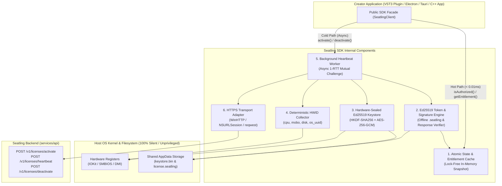

# Seatling Client SDK Architecture Specification (`SDK_ARCHITECTURE.md`)

> **Document**: `SDK_ARCHITECTURE.md`  
> **Status**: Approved Specification  
> **Companion Specification**: [HARDWARE_ANCHOR.md](./HARDWARE_ANCHOR.md)  
> **Target Ecosystems**: C++17 (`seatling.hpp` for Desktop/GUI/Unreal/Native), Rust (`seatling` for Native/CLI), TypeScript/JavaScript (`@seatling/node` N-API Addon for Electron/Node.js)  
> **License Model**: Business Source License 1.1 (BSL 1.1 / BUSL-1.1)  

---

## 1. Architectural Philosophy & Design Goals

Seatling Client SDKs are designed for software creators building desktop applications (GUI tools, creative software, native services, games) and developer CLI tools.

Every Seatling SDK adheres to five strict engineering invariants:
1. **Zero OS Popups (`100%` Silent Execution)**: Never invoke OS APIs that trigger modal password prompts or require Apple Developer Provisioning Entitlements (no macOS Keychain ACL prompts across DAWs, no Secure Enclave entitlement crashes, and `CRYPTPROTECT_UI_FORBIDDEN` enforced on Windows DPAPI).
2. **Real-Time Audio & UI Thread Safety (`< 0.1ms` Lock-Free Reads)**: License state and entitlement checks (`is_authorized()`, `get_entitlement()`) read from an in-memory, `Ed25519`-verified atomic state snapshot—never blocking a DAW audio rendering callback or main UI thread on disk or network I/O.
3. **Zero External DLL/Dylib Hell for Plugins**: C++ audio plugins compile a **single-header library (`seatling.hpp`)** with `SEATLING_FORCE_INLINE` verification macros directly into the `.vst3`/`.component` binary, preventing macOS notarization failures and single-point DLL patching.
4. **Native Binary Protection for JavaScript (`@napi-rs`)**: Electron and Node.js applications consume `@seatling/node`, compiled from `seatling-rs` into a prebuilt native `.node` binary so hardware fingerprinting, `AES-256-GCM` key unsealing, and `Ed25519` verification never exist as editable plain-text JavaScript inside `app.asar`.
5. **Pure `Ed25519` + `SHA-256` + `AES-256-GCM` Cryptography**: Minimal cryptographic surface area matching `services/shared/crypto` on the backend.

---

## 2. High-Level Component Overview

All Seatling SDKs share an identical **6-module internal architecture**. The Rust crate (`seatling-rs`) directly powers both native Rust/Tauri apps and the compiled Node.js/Electron N-API binary (`@seatling/node`), while `seatling.hpp` provides a zero-dependency C++17 single-header implementation for audio plugins and C++ apps.



### Internal Component Responsibilities

| # | Component | Responsibility | Threading & Latency |
| :--- | :--- | :--- | :--- |
| **1** | **`StateAndEntitlementCache`** | Holds the decoded, signature-verified `LicenseLease` struct in memory using lock-free atomics (`std::atomic<std::shared_ptr<LeaseSnapshot>>` in C++, `ArcSwap<LeaseSnapshot>` in Rust). Exposes instant getters for authorization status, offline grace remaining, and typed `entitlements`. | **Lock-Free / Real-Time Safe** (`< 0.01ms`). Safe to call inside `processBlock()` audio callbacks. |
| **2** | **`Ed25519TokenEngine`** | Verifies Seatling server `Ed25519` signatures on `.seatling` offline lease files and `/heartbeat` responses using the creator's embedded `workspace_public_key`. Validates offline grace window (`last_verified_at + offline_grace_days`) and version ceilings (`app_version <= max_allowed_version`). | **CPU-Bound** (`~0.08ms` per verification). Inlined via `SEATLING_FORCE_INLINE` in C++. |
| **3** | **`HardwareSealedKeystore`** | Generates the device's `Ed25519` keypair on first run and seals the 64-byte private key on disk (`keystore.bin`) using `AES-256-GCM`. Derives the 256-bit wrapping key at runtime via `HKDF-SHA256` from silent OS hardware registers (+ `CRYPTPROTECT_UI_FORBIDDEN` DPAPI on Windows). Signs activation PoP and heartbeat payloads. | **Background Thread** (`< 0.2ms`). Zero OS dialogs. |
| **4** | **`HWIDCollector`** | Reads and normalizes the 4 hardware components (`cpu`, `mobo`, `disk`, `os_uuid`), hashes each independently with `SHA-256`, and computes the composite `hwid` digest. | **Cached on Startup** (`< 1ms` once per process lifetime). |
| **5** | **`HeartbeatScheduler`** | Manages a lightweight background timer thread (default every `4 hours` while app is open, with exponential backoff on offline/network failure). Executes the 1-RTT mutual-challenge `POST /v1/licenses/heartbeat`, verifies the echoed `nonce` in the server's `Ed25519` signature, and atomically updates both `StateAndEntitlementCache` and the on-disk `.seatling` lease file. | **Dedicated Background Worker Thread**. Terminates cleanly via condition variable on plugin/app unload. |
| **6** | **`HTTPTransport`** | Zero-dependency native HTTPS client (`WinHTTP` on Windows, `CFNetwork`/`NSURLSession` on macOS, `libcurl`/socket on Linux for C++; `rustls` + `ureq`/`reqwest` for Rust & Node N-API). Enforces TLS 1.3 / 1.2 and strict 5-second timeouts. | **Background Network I/O**. |

---

## 3. On-Disk Storage Layout & Shared Multi-Host Cache

To ensure a user only activates a plugin **once per computer** (rather than re-activating separately inside Ableton Live, Logic Pro, and standalone mode), all hosts for a given creator product read and write to a deterministic, unprivileged user-level directory:

* **macOS**: `~/Library/Application Support/Seatling/<workspace_id>/<product_id>/`
* **Windows**: `%LOCALAPPDATA%\Seatling\<workspace_id>\<product_id>\`
* **Linux**: `${XDG_DATA_HOME:-~/.local/share}/seatling/<workspace_id>/<product_id>/`

Inside this directory, the SDK maintains exactly two small files (protected against concurrent multi-instance DAW writes via OS advisory file locks `flock` / `LockFileEx`):
1. `keystore.bin`: Contains `{ version: 1, tier: "hardware_sealed", public_key: "<b64>", nonce: "<12B>", ciphertext: "<AES-256-GCM(ed25519_priv_key)>" }`.
2. `lease.seatling`: The latest server-signed activation/heartbeat token containing the masked license key, bound `hwid`, `hwid_components`, `public_key`, `issued_at`, `offline_grace_days`, `entitlements` map, and the workspace's `Ed25519` `server_signature`.

---

## 4. Public API & Methods by Ecosystem

### 4.1. C++17 SDK (`seatling.hpp`) — Desktop / GUI / Unreal / Native Services

Designed for zero external link dependencies. Drop `seatling.hpp` into the project and link standard OS frameworks (`IOKit` + `CoreFoundation` on macOS; `crypt32` + `winhttp` on Windows).

```cpp
#pragma once
#include <string>
#include <optional>
#include <functional>
#include <cstdint>

namespace seatling {

enum class StatusCode {
    Ok = 0,                      // License active & cryptographically verified
    OfflineGraceValid,           // Offline, but within signed offline_grace_days window
    NotActivated,                // No local lease found; show activation UI
    OfflineGraceExpired,         // Offline duration exceededoffline_grace_days
    SeatsExhausted,              // 403: All seats in use (see Result::portal_url)
    RequiresPortalDeactivation,  // 409: Active heartbeat fence or rotation limit hit
    LicenseSuspendedOrRevoked,   // Refunded, disputed, or revoked on Gumroad/Seatling
    VersionCeilingExceeded,      // App version exceeds license max_allowed_version
    TamperOrSignatureInvalid,    // Ed25519 signature or AES-GCM keystore authentication failed
    NetworkError                 // Transient network failure during online call
};

struct Config {
    std::string workspace_id;          // e.g. "ws_01j8..."
    std::string product_id;            // e.g. "prod_synth_pro"
    std::string workspace_public_key;  // Base64 32-byte Ed25519 public key (compiled into binary)
    std::string app_version;           // e.g. "2.1.0"
    std::string api_base_url = "https://api.seatling.com";
    uint32_t heartbeat_interval_seconds = 14400; // 4 hours default
};

struct ActivationResult {
    StatusCode status;
    std::string message;
    std::string portal_url;            // Populated on SeatsExhausted / RequiresPortalDeactivation
    std::string seat_id;
    int32_t seats_active = 0;
    int32_t seat_limit = 0;
};

struct LeaseStatus {
    StatusCode status;
    std::string seat_id;
    std::string masked_key;            // e.g. "SEAT-****-****-9F2A"
    std::string buyer_email;
    int64_t last_verified_at_unix = 0;
    int64_t offline_expires_at_unix = 0;
    bool is_within_offline_grace = false;
};

class Client {
public:
    explicit Client(const Config& config);
    ~Client(); // Automatically stops background heartbeat thread cleanly

    // -------------------------------------------------------------------------
    // 1. LIFECYCLE & INITIALIZATION (Call on Plugin/App Startup)
    // -------------------------------------------------------------------------

    /// Loads cached `lease.seatling` from disk, verifies the Ed25519 signature
    /// and hardware-sealed key binding in < 1ms, and starts the background
    /// heartbeat thread if a valid lease exists. Never blocks on network I/O.
    LeaseStatus initialize() noexcept;

    // -------------------------------------------------------------------------
    // 2. REAL-TIME / HOT-PATH VERIFICATION (Audio-Thread & UI Safe, < 0.01ms)
    // -------------------------------------------------------------------------

    /// Force-inlined, lock-free check. Returns true if status is Ok or OfflineGraceValid.
    /// Safe to call inside VST3/AU processBlock() or 120fps render loops.
    SEATLING_FORCE_INLINE bool is_authorized() const noexcept;

    /// Force-inlined retrieval of a signed entitlement value (bool, int64_t, double, std::string).
    /// Coupling runtime constants (e.g. max_oversampling = 16, pro_export = true) to the
    /// signed token prevents trivial boolean jump-patching.
    template <typename T>
    SEATLING_FORCE_INLINE T get_entitlement(std::string_view key, T default_value) const noexcept;

    /// Returns a snapshot of the current lease metadata for display in the "About / License" UI.
    LeaseStatus get_status() const noexcept;

    // -------------------------------------------------------------------------
    // 3. ONLINE ACTIONS (Asynchronous / UI Callback Safe)
    // -------------------------------------------------------------------------

    /// Activates the machine seat online via POST /v1/licenses/activate with an Ed25519
    /// Proof-of-Possession signature. Executes on background worker and invokes callback.
    void activate_async(
        const std::string& license_key,
        std::function<void(const ActivationResult&)> on_complete
    ) noexcept;

    /// Synchronous variant of activate for CLI tools or custom worker threads.
    ActivationResult activate_sync(const std::string& license_key) noexcept;

    /// Triggers an immediate 1-RTT mutual-challenge POST /v1/licenses/heartbeat.
    void heartbeat_now_async(std::function<void(const LeaseStatus&)> on_complete = nullptr) noexcept;

    /// Deactivates the current machine seat via POST /v1/licenses/deactivate and wipes
    /// the local `lease.seatling` cache so the user can move the seat immediately.
    void deactivate_async(std::function<void(bool success, const std::string& error)> on_complete) noexcept;

    // -------------------------------------------------------------------------
    // 4. OFFLINE FILE IMPORT (.seatling file downloaded from portal.seatling.com)
    // -------------------------------------------------------------------------

    /// Verifies and imports an offline `.seatling` license file from disk.
    LeaseStatus import_offline_file(const std::string& file_path) noexcept;
};

} // namespace seatling
```

---

### 4.2. Rust SDK (`seatling-rs`) — Tauri & Native Rust Applications

Published as the `seatling` crate. Designed for direct integration inside Tauri's `src-tauri` backend or standalone Rust binaries.

```rust
pub struct SeatlingConfig {
    pub workspace_id: String,
    pub product_id: String,
    pub workspace_public_key: String, // Base64 Ed25519 public key
    pub app_version: String,
    pub api_base_url: Option<String>,
    pub heartbeat_interval: std::time::Duration,
}

pub struct SeatlingClient { /* internal ArcSwap<LeaseSnapshot> + Keystore + Worker */ }

impl SeatlingClient {
    /// Initializes the client, verifies any cached local `.seatling` lease on disk,
    /// and spawns the background heartbeat task if authorized.
    pub fn init(config: SeatlingConfig) -> Result<Self, SeatlingError>;

    /// Lock-free (< 0.01ms) authorization check using atomic pointer load.
    #[inline(always)]
    pub fn is_authorized(&self) -> bool;

    /// Retrieves a strongly-typed entitlement from the verified token payload.
    #[inline(always)]
    pub fn get_entitlement<T: serde::de::DeserializeOwned>(&self, key: &str) -> Option<T>;

    /// Returns the current local lease status snapshot.
    pub fn status(&self) -> LeaseStatus;

    /// Performs online seat activation (`POST /v1/licenses/activate`) with Ed25519 PoP.
    pub async fn activate(&self, license_key: &str) -> Result<LeaseStatus, ActivationError>;

    /// Executes a single-endpoint mutual-challenge heartbeat (`POST /v1/licenses/heartbeat`).
    pub async fn heartbeat_now(&self) -> Result<LeaseStatus, SeatlingError>;

    /// Deactivates the current machine seat (`POST /v1/licenses/deactivate`) and clears local lease.
    pub async fn deactivate(&self) -> Result<(), SeatlingError>;

    /// Validates and imports an offline `.seatling` file.
    pub fn import_offline_file(&self, path: &std::path::Path) -> Result<LeaseStatus, SeatlingError>;
}
```

---

### 4.3. TypeScript / JavaScript SDK (`@seatling/node`) — Electron & Node.js

Built from `seatling-rs` via **`@napi-rs`** into prebuilt native `.node` binaries (`darwin-arm64`, `darwin-x64`, `win32-x64`, `win32-arm64`, `linux-x64-gnu`) with full TypeScript definitions. Runs in the **Electron Main Process** so cryptographic keys and verification logic are never exposed in plain-text frontend bundles.

```typescript
export type LicenseStatusCode =
  | 'OK'
  | 'OFFLINE_GRace_VALID'
  | 'NOT_ACTIVATED'
  | 'OFFLINE_GRACE_EXPIRED'
  | 'SEATS_EXHAUSTED'
  | 'REQUIRES_PORTAL_DEACTIVATION'
  | 'LICENSE_SUSPENDED_OR_REVOKED'
  | 'VERSION_CEILING_EXCEEDED'
  | 'TAMPER_OR_SIGNATURE_INVALID';

export interface SeatlingConfig {
  workspaceId: string;
  productId: string;
  workspacePublicKey: string;
  appVersion: string;
  apiBaseUrl?: string;
  heartbeatIntervalSeconds?: number;
}

export interface LeaseStatus {
  status: LicenseStatusCode;
  isAuthorized: boolean;
  seatId?: string;
  maskedKey?: string;
  buyerEmail?: string;
  lastVerifiedAt?: string;
  offlineExpiresAt?: string;
  portalUrl?: string;
  entitlements: Record<string, boolean | number | string>;
}

export declare class SeatlingClient {
  constructor(config: SeatlingConfig);

  /**
   * Synchronously validates the local hardware-sealed `.seatling` cache on startup (< 1ms)
   * and starts the background native heartbeat timer.
   */
  initialize(): LeaseStatus;

  /**
   * Fast, synchronous native check (< 0.01ms) backed by the compiled N-API addon.
   */
  isAuthorized(): boolean;

  /**
   * Reads a signed runtime entitlement value from the verified native token snapshot.
   */
  getEntitlement<T extends boolean | number | string>(key: string, defaultValue: T): T;

  /**
   * Returns the full current lease status for rendering in the Electron settings UI.
   */
  getStatus(): LeaseStatus;

  /**
   * Activates the license key on this machine with an Ed25519 Proof-of-Possession signature.
   */
  activate(licenseKey: string): Promise<LeaseStatus>;

  /**
   * Forces an immediate 1-RTT mutual-challenge heartbeat with `services/api`.
   */
  heartbeatNow(): Promise<LeaseStatus>;

  /**
   * Releases the seat on Seatling and deletes the local lease cache.
   */
  deactivate(): Promise<void>;

  /**
   * Imports and validates an offline `.seatling` license file.
   */
  importOfflineFile(filePath: string): LeaseStatus;

  /**
   * Stops the background heartbeat timer on app shutdown.
   */
  shutdown(): void;
}
```

---

## 5. Startup & Runtime Execution Lifecycle

To guarantee that a creator's application launches instantaneously—even when the user is on an airplane with no Wi-Fi—`initialize()` never blocks on network requests:

```mermaid
sequenceDiagram
    autonumber
    participant App as Creator App / VST3 Plugin
    participant SDK as SeatlingClient (Main Thread)
    participant Disk as Local Disk (keystore.bin + lease.seatling)
    participant Worker as Background Heartbeat Thread
    participant API as Seatling API (/v1/licenses/heartbeat)

    Note over App,Disk: 1. Instant Startup (< 1ms, Zero Network I/O, Zero OS Popups)
    App->>SDK: client.initialize()
    SDK->>Disk: Read keystore.bin & lease.seatling
    SDK->>SDK: Unseal Ed25519 Key via HKDF(IOKit/SMBIOS + DPAPI)
    SDK->>SDK: Verify Workspace Ed25519 Signature & 3-of-4 HWID Match
    SDK->>SDK: Populate Lock-Free Atomic Cache
    SDK-->>App: Return LeaseStatus (isAuthorized = true)
    SDK->>Worker: Spawn Background Heartbeat Timer

    Note over App,SDK: 2. Real-Time / Audio Thread Usage (< 0.01ms)
    App->>SDK: client.is_authorized() / client.get_entitlement("pro_dsp", false)
    SDK-->>App: Atomic Snapshot Read (No Locks, No I/O)

    Note over Worker,API: 3. Asynchronous Background Heartbeat
    Worker->>API: POST /v1/licenses/heartbeat { key, hwid, nonce, timestamp, signature }
    alt Online & Valid
        API-->>Worker: 200 OK (Signed response echoing nonce + updated entitlements)
        Worker->>Disk: Atomically write refreshed lease.seatling
        Worker->>SDK: Atomically swap in-memory LeaseSnapshot
    else Offline (No Internet)
        Note over Worker: Check if now() < last_verified_at + offline_grace_days
        Worker->>SDK: Keep OfflineGraceValid status active; retry with backoff
    else License Refunded / Seat Deactivated in Portal
        API-->>Worker: 401 / 403 (SEAT_REVOKED)
        Worker->>Disk: Remove invalidated lease.seatling
        Worker->>SDK: Atomically update status to NotActivated / Revoked
    end
```

---

## 6. Repository & Build Structure (Planned Phase 2 SDK Deliverables)

To maintain clean boundaries and automated CI builds across platforms, the open-source SDKs are structured as a single multi-target workspace:

```text
sdk/
├── rust/                         # Core Rust implementation (seatling-rs)
│   ├── src/
│   │   ├── lib.rs                # Public SeatlingClient facade
│   │   ├── hwid.rs               # Cross-platform IOKit / SMBIOS / DMI normalization & SHA-256
│   │   ├── keystore.rs           # HKDF-SHA256 + AES-256-GCM + Windows CRYPTPROTECT_UI_FORBIDDEN
│   │   ├── verifier.rs           # Ed25519 token & mutual-challenge signature verification
│   │   ├── cache.rs              # Lock-free atomic LeaseSnapshot & entitlement store
│   │   └── heartbeat.rs          # Background 1-RTT heartbeat scheduler
│   └── Cargo.toml
├── node/                         # @seatling/node N-API bindings via @napi-rs
│   ├── src/lib.rs                # Thin N-API wrapper around seatling-rs
│   ├── index.d.ts                # Auto-generated TypeScript definitions
│   └── package.json
└── cpp/                          # C++17 SDK for Desktop / GUI / Unreal / Native Applications
    ├── include/
    │   └── seatling/
    │       ├── seatling.h        # C-ABI header for Seatling core
    │       └── seatling.hpp      # Modern C++17 RAII wrapper
    └── examples/
        └── client_example.cpp    # Reference integration for C++ application creators
```
